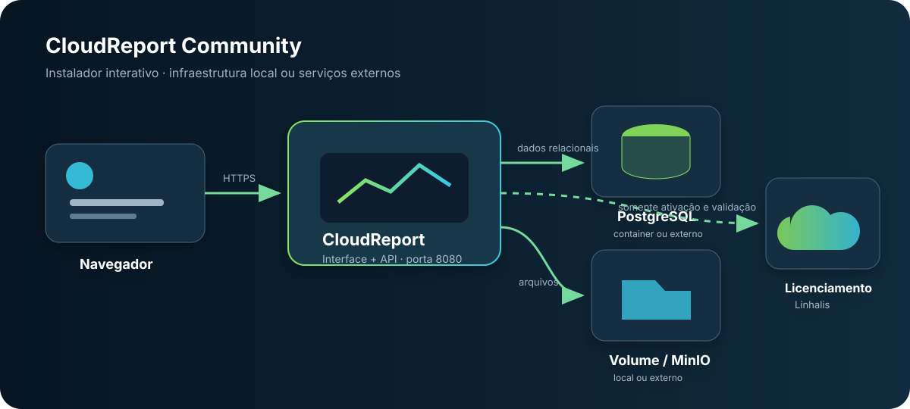

# CloudReport — deployment


This repository contains only the files required to install and update **CloudReport** with Docker Compose. The interactive installer generates secrets, builds the configuration, and waits until the application is ready.

> The image and deployment are not tied to a plan. The effective license is configured and validated by the application at runtime.

[Versão em português](README.md) · [Terms of Use](TERMS-OF-USE.en.md) · [Privacy Policy](PRIVACY-POLICY.en.md)

## Quick installation

No GitHub or Docker Hub account and no CloudReport source-code access are required. On a new Linux server, download the public installer as `cloudreport`, inspect it if desired, and run it:

```bash
curl -fsSLo cloudreport https://raw.githubusercontent.com/rovannlinhalis/linhalis-cloudreport-deploy/main/install.sh
chmod +x cloudreport
sudo ./cloudreport
```

The script displays the CloudReport identity and ASCII logo and guides the entire installation. It generates secrets, pulls the public `docker.io/rovann/cloudreport:latest` image, creates the configuration, starts the selected services, and only finishes after the API responds.

## Architecture



The installer supports any combination of:

| Component | Installer-managed option | External option |
| --- | --- | --- |
| Database | PostgreSQL 17 container with randomly generated credentials | Existing PostgreSQL with host, port, database, user, password, and TLS settings |
| Files | Persistent Docker volume mounted at `/data/storage` | Existing MinIO with endpoint, credentials, bucket, and TLS settings |

The integrated PostgreSQL port is not published on the host. Only the selected CloudReport HTTP port is exposed. Cryptographic keys stay in the `cloudreport-data` volume. The installation identity is stored at `state/instance/identity.key`, outside the container recreation lifecycle, even when the database and MinIO are external.

## Requirements

- Linux with administrative access (`root` or `sudo`);
- Docker Engine 24 or newer and Docker Compose v2 (`docker compose`), or permission for the installer to configure them;
- `curl`;
- 2 GB of available RAM; 4 GB recommended;
- a domain pointing to the server and an HTTPS proxy for public use; no domain is required for local-network-only use.

For external PostgreSQL, create an empty database first and grant the user permission to create and alter its schema. For external MinIO, the endpoint must be reachable by both the container and browsers opening signed URLs. MinIO credentials must be able to check or create the bucket, list its contents, and read, write, and delete objects; an object-only policy is not sufficient for the initial bucket check.

### ODBC data sources

The default image includes only the `libodbc2` runtime library. It does not include the `isql`/`iusql` tools or database- or vendor-specific drivers. To use an ODBC report data source, build a derived CloudReport image that installs the compatible driver and its libraries, together with any required `odbcinst.ini` or `odbc.ini` configuration. Drivers installed only on the Docker host are not available inside the container. Set `DRIVER` to the name registered in `odbcinst.ini`; library paths are rejected.

The dedicated PostgreSQL, MySQL, and SQL Server data sources use their own .NET providers and do not depend on an ODBC driver. For ODBC, keep the database credential read-only and verify that the driver name used in the connection string exists in the derived image. `FILEDSN`, `SAVEFILE`, `DBQ`, database files, local sockets/pipes, logs, and library paths are not accepted. When private networks are blocked, use a recognized PostgreSQL, MySQL, MariaDB, or SQL Server driver and provide the host explicitly; `DSN` requires private-network access to be enabled by an administrator.

## Guided installation

The recommended command downloads the script as `cloudreport`:

```bash
curl -fsSLo cloudreport https://raw.githubusercontent.com/rovannlinhalis/linhalis-cloudreport-deploy/main/install.sh
chmod +x cloudreport
sudo ./cloudreport
```

When running from a clone of this repository, use:

```bash
sudo bash install.sh
```

The wizard asks for:

1. installation directory;
2. access through a local-network address or a public domain behind an HTTPS proxy;
3. bind IP, HTTP port, and final application URL;
4. a dedicated PostgreSQL container or an existing PostgreSQL server, including host, port, database, user, password, and TLS;
5. a persistent local volume or an existing MinIO server, including endpoint, credentials, bucket, and TLS;
6. Docker image and final confirmation.

For local access, the default publishes the application on every server interface. For a public domain, the default publishes only on `127.0.0.1`, so that a proxy on the same host is the only exposed entry point. The installer detects a conflict on the selected port when the operating system provides that check.

The integrated PostgreSQL password is generated automatically. The installer also always generates the JWT key. If Docker and Compose are not yet available, the wizard offers to install them through Docker's official installer. The default result is stored under `/opt/cloudreport`:

```text
/opt/cloudreport/
├── .env                 # configuration and secrets, mode 600
├── docker-compose.yml
├── install-report.txt   # credentials report, mode 600
├── install.sh
├── state/instance/      # stable installation identity
└── update.sh
```

The script validates the Compose model, pulls the public images, starts PostgreSQL when selected, waits for the database, applies migrations, and only finishes after `/api/bootstrap` responds successfully. It then writes `install-report.txt` with the address, infrastructure choices, and first-access and proxy guidance.

## First access

Open the URL entered during installation. The web setup wizard asks for:

- the contract title plus the registrant's name, email, and optional organization;
- acceptance of the Terms of Use and Privacy Policy;
- creation of the local administrator after license activation.

A new installation starts the self-service Community plan registration on first access. Installing the containers does not silently create a license: the registrant completes the in-product setup and then creates the single administrator allowed by the Community plan.

Complete the first access immediately and keep the port restricted to your network until registration is finished. On an empty installation, the first person to complete this step becomes the administrator.

The registrant details and technical installation identifier are sent to Linhalis to issue and maintain the free contract. The administrator password, local users, projects, data sources, reports, and files remain in your installation.

## Updating

The updater downloads the latest Compose file, preserves `.env`, volumes, and the installation identifier, forces application container recreation, and checks that the bootstrap endpoint responds again. On the first update to this version, the script automatically migrates `identity.key` from the existing container to the stable host directory:

```bash
cd /opt/cloudreport
sudo ./update.sh
```

To pin a release:

```bash
sudo CLOUDREPORT_INSTALL_VERSION=1.2.3 ./update.sh
```

## Operations

```bash
cd /opt/cloudreport
docker compose ps
docker compose logs -f cloudreport
docker compose down
```

`docker compose down` preserves volumes. `docker compose down -v` deletes the integrated PostgreSQL database, local files, and keys; the identity under `state/instance` remains. Do not use `-v` without a valid backup. External PostgreSQL and MinIO data are not removed by Compose.

## Backup

With integrated PostgreSQL:

```bash
cd /opt/cloudreport
docker compose exec -T postgres pg_dump -U cloudreport -d cloudreport -Fc > cloudreport.dump
```

Also back up the `cloudreport-data` volume and `/opt/cloudreport/state/instance`; they contain cryptographic keys/local files and the installation identity, respectively. The `postgres-data` volume contains the integrated database. If PostgreSQL or MinIO is external, include it in your infrastructure backup policy.

## Manual configuration

`install.sh` is the recommended path. For custom automation, copy `.env.example` to `.env`, replace every `CHANGE_ME` value, and validate before starting:

```bash
docker compose config --quiet
docker compose pull
docker compose up -d
```

Use `COMPOSE_PROFILES=database` only to enable integrated PostgreSQL. Leave `COMPOSE_PROFILES` empty when using an external database.

## HTTPS

For public use, do not expose the application's HTTP port directly. Select the public-domain option in the installer, keep the default `127.0.0.1` bind, and forward the domain to `127.0.0.1:APP_PORT` with Caddy, Traefik, Nginx, or your platform proxy.

Minimal Caddy example, which automatically issues and renews the certificate when DNS and ports 80/443 are correctly configured:

```caddyfile
reports.example.com {
    reverse_proxy 127.0.0.1:8080
}
```

Example main Nginx block after configuring a valid certificate:

```nginx
server {
    listen 443 ssl;
    server_name reports.example.com;
    ssl_certificate /etc/letsencrypt/live/reports.example.com/fullchain.pem;
    ssl_certificate_key /etc/letsencrypt/live/reports.example.com/privkey.pem;
    client_max_body_size 50m;

    location / {
        proxy_pass http://127.0.0.1:8080;
        proxy_http_version 1.1;
        proxy_set_header Host $host;
        proxy_set_header X-Real-IP $remote_addr;
        proxy_set_header X-Forwarded-For $proxy_add_x_forwarded_for;
        proxy_set_header X-Forwarded-Proto $scheme;
    }
}
```

Allow ports 80/443 through the firewall for the proxy, preserve `Host`, `X-Forwarded-For`, and `X-Forwarded-Proto`, and support uploads large enough for your reports. If the domain changes, update `PUBLIC_URL` in `/opt/cloudreport/.env` and recreate the `cloudreport` container.

## Licensing and plans

The effective plan is obtained from the license contract at runtime. Changing the license does not require rebuilding the image or redeploying the application. For commercial information, contact the [official WhatsApp](https://wa.me/5527995790376).

CloudReport is distributed under a [proprietary license](LICENSE), while third-party libraries and operating-system components remain under their respective licenses. The published image includes inventories, attributions, and license texts generated during the build. View them in the installed instance at `/third-party-licenses/THIRD-PARTY-NOTICES.txt`.

## Support

The product does not include free support, an SLA, consulting, deployment assistance, or data recovery. Professional services may be purchased separately through Linhalis channels.
