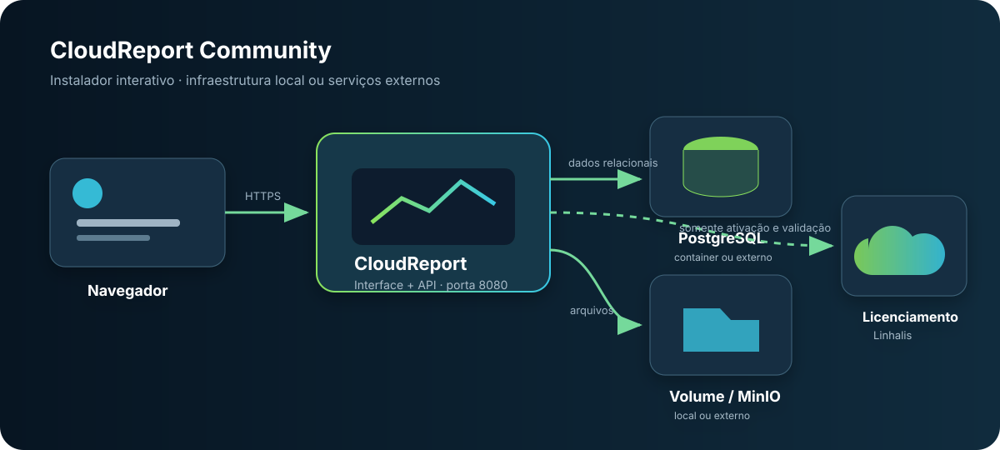

# CloudReport — deploy


Este repositório contém somente os arquivos necessários para instalar e atualizar o **CloudReport** com Docker Compose. O instalador interativo gera os segredos, monta a configuração e aguarda a aplicação ficar pronta.

> A imagem e o deploy não são vinculados a um plano. A licença efetiva é configurada e validada pela aplicação em tempo de execução.

[English version](README.en.md) · [Termos de Uso](TERMS-OF-USE.md) · [Política de Privacidade](PRIVACY-POLICY.md)

## Arquitetura



O instalador permite combinar:

| Componente | Opção gerenciada pelo instalador | Opção externa |
| --- | --- | --- |
| Banco de dados | PostgreSQL 17 em container, com credenciais aleatórias | PostgreSQL existente, com host, porta, banco, usuário, senha e TLS |
| Arquivos | volume Docker persistente em `/data/storage` | MinIO existente, com endpoint, credenciais, bucket e TLS |

O PostgreSQL integrado não publica sua porta no host. Somente a porta HTTP escolhida para o CloudReport é publicada. As chaves criptográficas permanecem no volume `cloudreport-data`. A identidade da instalação fica em `state/instance/identity.key`, fora do ciclo de recriação do container, inclusive quando banco e MinIO são externos.

## Requisitos

- Linux com acesso administrativo (`root` ou `sudo`);
- Docker Engine 24 ou mais recente;
- Docker Compose v2 (`docker compose`);
- `curl`;
- 2 GB de RAM disponíveis; 4 GB recomendados;
- domínio e proxy HTTPS para uso público.

Para PostgreSQL externo, crie previamente um banco vazio e conceda ao usuário permissão para criar e alterar o esquema. Para MinIO externo, o endpoint deve ser alcançável pelo container e pelos navegadores que abrirão URLs assinadas.

### Fontes de dados ODBC

A imagem padrão inclui o gerenciador `unixODBC`, mas não inclui drivers específicos de bancos ou fornecedores. Para usar uma fonte ODBC em um relatório, crie uma imagem derivada do CloudReport que instale o driver compatível e suas bibliotecas, além de qualquer configuração `odbcinst.ini` ou `odbc.ini` necessária. Drivers instalados somente no host não ficam disponíveis dentro do container. Use em `DRIVER` o nome registrado em `odbcinst.ini`; caminhos para a biblioteca são rejeitados.

As fontes dedicadas PostgreSQL, MySQL e SQL Server usam provedores próprios do .NET e não dependem de um driver ODBC. Para ODBC, mantenha a credencial do banco restrita a consultas e confirme que o nome do driver usado na connection string existe na imagem derivada. `FILEDSN`, `SAVEFILE`, `DBQ`, arquivos de banco, sockets/pipes locais, logs e caminhos de bibliotecas não são aceitos. Com redes privadas bloqueadas, use um driver reconhecido de PostgreSQL, MySQL, MariaDB ou SQL Server e informe o host explicitamente; `DSN` requer liberação administrativa de redes privadas.

## Instalação

Baixe e execute o instalador:

```bash
curl -fsSLo install.sh https://raw.githubusercontent.com/rovannlinhalis/linhalis-cloudreport-deploy/main/install.sh
sudo bash install.sh
```

Ao executar a partir de um clone deste repositório, basta usar:

```bash
sudo bash install.sh
```

O assistente solicita:

1. diretório de instalação, URL pública, IP de publicação e porta;
2. PostgreSQL integrado ou externo;
3. volume local ou MinIO externo;
4. imagem Docker e confirmação final.

No PostgreSQL integrado, a senha é gerada automaticamente. A chave JWT também é sempre gerada pelo instalador. O resultado padrão fica em `/opt/cloudreport`:

```text
/opt/cloudreport/
├── .env                 # configuração e segredos, permissão 600
├── docker-compose.yml
├── install-report.txt   # relatório com credenciais, permissão 600
├── install.sh
├── state/instance/      # identidade estável da instalação
└── update.sh
```

O script valida o Compose, baixa as imagens, inicia o PostgreSQL quando selecionado, aguarda o banco e só conclui depois que `/api/bootstrap` responde com sucesso.

## Primeiro acesso

Abra a URL informada no instalador. O assistente web solicitará:

- título do contrato, nome, e-mail e organização opcional do responsável pelo registro;
- aceite dos Termos de Uso e da Política de Privacidade;
- criação do administrador local após a licença ser ativada.

Faça o primeiro acesso imediatamente e mantenha a porta restrita à sua rede até concluir o cadastro. Em uma instalação vazia, a primeira pessoa que concluir essa etapa se torna administradora.

Os dados do responsável e o identificador técnico da instalação são enviados à Linhalis para emitir e manter o contrato gratuito. A senha do administrador, usuários locais, projetos, fontes de dados, relatórios e arquivos permanecem na sua instalação.

## Atualização

O atualizador baixa o Compose mais recente, preserva `.env`, volumes e o identificador da instalação, força a recriação do container da aplicação e confirma que o bootstrap voltou a responder. Na primeira atualização desta versão, o script migra automaticamente `identity.key` do container existente para o diretório estável do host:

```bash
cd /opt/cloudreport
sudo ./update.sh
```

Para fixar uma versão:

```bash
sudo CLOUDREPORT_INSTALL_VERSION=1.2.3 ./update.sh
```

## Operação

```bash
cd /opt/cloudreport
docker compose ps
docker compose logs -f cloudreport
docker compose down
```

`docker compose down` preserva os volumes. `docker compose down -v` apaga o PostgreSQL integrado, os arquivos locais e as chaves; a identidade em `state/instance` não é removida. Não utilize `-v` sem backup válido. Banco e MinIO externos não são apagados pelo Compose.

## Backup

Com PostgreSQL integrado:

```bash
cd /opt/cloudreport
docker compose exec -T postgres pg_dump -U cloudreport -d cloudreport -Fc > cloudreport.dump
```

Faça também backup do volume `cloudreport-data` e de `/opt/cloudreport/state/instance`, pois eles contêm, respectivamente, chaves/arquivos locais e a identidade da instalação. O volume `postgres-data` contém o banco integrado. Se usar PostgreSQL ou MinIO externos, inclua-os na política de backup da sua infraestrutura.

## Configuração manual

O caminho recomendado é `install.sh`. Para automação própria, copie `.env.example` para `.env`, substitua todos os valores `CHANGE_ME` e valide antes de iniciar:

```bash
docker compose config --quiet
docker compose pull
docker compose up -d
```

Use `COMPOSE_PROFILES=database` somente para habilitar o PostgreSQL integrado. Com banco externo, deixe `COMPOSE_PROFILES` vazio.

## HTTPS

Use Caddy, Traefik, Nginx ou o proxy da sua plataforma. Encaminhe o domínio público para `http://IP_DE_BIND:APP_PORT`, preserve `Host`, `X-Forwarded-For` e `X-Forwarded-Proto` e aceite uploads compatíveis com o tamanho dos relatórios.

## Licenciamento e planos

O plano efetivo é obtido do contrato de licença em tempo de execução. Alterar a licença não exige reconstruir a imagem nem refazer o deploy. Para informações comerciais, entre em contato pelo [WhatsApp oficial](https://wa.me/5527995790376).

## Suporte

O produto não inclui suporte gratuito, SLA, consultoria, implantação ou recuperação de dados. Serviços profissionais podem ser contratados separadamente pelos canais da Linhalis.
