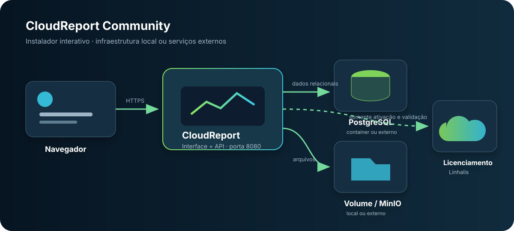

# CloudReport — deploy


Este repositório contém somente os arquivos necessários para instalar e atualizar o **CloudReport** com Docker Compose. O instalador interativo gera os segredos, monta a configuração e aguarda a aplicação ficar pronta.

> A imagem e o deploy não são vinculados a um plano. A licença efetiva é configurada e validada pela aplicação em tempo de execução.

[English version](README.en.md) · [Termos de Uso](TERMS-OF-USE.md) · [Política de Privacidade](PRIVACY-POLICY.md)

## Instalação rápida

Não é necessário ter conta no GitHub, no Docker Hub ou acesso ao código-fonte do CloudReport. Em um servidor Linux novo, baixe o instalador público com o nome `cloudreport`, revise-o se desejar e execute:

```bash
curl -fsSLo cloudreport https://raw.githubusercontent.com/rovannlinhalis/linhalis-cloudreport-deploy/main/install.sh
chmod +x cloudreport
sudo ./cloudreport
```

O script exibe a identificação e o logotipo ASCII do CloudReport e conduz toda a instalação. Ele gera os segredos, baixa a imagem pública `docker.io/rovann/cloudreport:latest`, cria a configuração, inicia os serviços escolhidos e só conclui quando a API estiver respondendo.

## Arquitetura



O instalador permite combinar:

| Componente | Opção gerenciada pelo instalador | Opção externa |
| --- | --- | --- |
| Banco de dados | PostgreSQL 17 em container, com credenciais aleatórias | PostgreSQL existente, com host, porta, banco, usuário, senha e TLS |
| Arquivos | volume Docker persistente em `/data/storage` | MinIO existente, com endpoint, credenciais, bucket e TLS |

O PostgreSQL integrado não publica sua porta no host. Somente a porta HTTP escolhida para o CloudReport é publicada. As chaves criptográficas permanecem no volume `cloudreport-data`. A identidade da instalação fica em `state/instance/identity.key`, fora do ciclo de recriação do container, inclusive quando banco e MinIO são externos.

## Requisitos

- Linux com acesso administrativo (`root` ou `sudo`);
- Docker Engine 24 ou mais recente e Docker Compose v2 (`docker compose`), ou permissão para o instalador configurá-los;
- `curl`;
- 2 GB de RAM disponíveis; 4 GB recomendados;
- domínio apontado para o servidor e proxy HTTPS para uso público; nenhum domínio é necessário para uso somente na rede local.

Para PostgreSQL externo, crie previamente um banco vazio e conceda ao usuário permissão para criar e alterar o esquema. Para MinIO externo, o endpoint deve ser alcançável pelo container e pelos navegadores que abrirão URLs assinadas. As credenciais do MinIO precisam permitir verificar ou criar o bucket, listar seu conteúdo e ler, gravar e remover objetos; uma política somente de objetos não é suficiente para a verificação inicial do bucket.

### Fontes de dados ODBC

A imagem padrão inclui somente a biblioteca de runtime `libodbc2`. Ela não inclui as ferramentas `isql`/`iusql` nem drivers específicos de bancos ou fornecedores. Para usar uma fonte ODBC em um relatório, crie uma imagem derivada do CloudReport que instale o driver compatível e suas bibliotecas, além de qualquer configuração `odbcinst.ini` ou `odbc.ini` necessária. Drivers instalados somente no host não ficam disponíveis dentro do container. Use em `DRIVER` o nome registrado em `odbcinst.ini`; caminhos para a biblioteca são rejeitados.

As fontes dedicadas PostgreSQL, MySQL e SQL Server usam provedores próprios do .NET e não dependem de um driver ODBC. Para ODBC, mantenha a credencial do banco restrita a consultas e confirme que o nome do driver usado na connection string existe na imagem derivada. `FILEDSN`, `SAVEFILE`, `DBQ`, arquivos de banco, sockets/pipes locais, logs e caminhos de bibliotecas não são aceitos. Com redes privadas bloqueadas, use um driver reconhecido de PostgreSQL, MySQL, MariaDB ou SQL Server e informe o host explicitamente; `DSN` requer liberação administrativa de redes privadas.

## Instalação assistida

O comando recomendado baixa o script como `cloudreport`:

```bash
curl -fsSLo cloudreport https://raw.githubusercontent.com/rovannlinhalis/linhalis-cloudreport-deploy/main/install.sh
chmod +x cloudreport
sudo ./cloudreport
```

Ao executar a partir de um clone deste repositório, basta usar:

```bash
sudo bash install.sh
```

O assistente solicita:

1. diretório de instalação;
2. acesso por endereço da rede local ou por domínio público atrás de proxy HTTPS;
3. IP de publicação, porta HTTP e URL final da aplicação;
4. PostgreSQL exclusivo em container ou PostgreSQL existente, incluindo host, porta, banco, usuário, senha e TLS;
5. volume local persistente ou MinIO existente, incluindo endpoint, credenciais, bucket e TLS;
6. imagem Docker e confirmação final.

Para acesso local, o padrão publica a aplicação em todas as interfaces do servidor. Para domínio público, o padrão publica somente em `127.0.0.1`, de forma que o proxy no mesmo host seja o único ponto exposto. O instalador detecta conflito na porta selecionada quando o sistema oferece essa verificação.

No PostgreSQL integrado, a senha é gerada automaticamente. A chave JWT também é sempre gerada pelo instalador. Se Docker e Compose ainda não estiverem disponíveis, o assistente oferece a instalação pelo instalador oficial do Docker. O resultado padrão fica em `/opt/cloudreport`:

```text
/opt/cloudreport/
├── .env                 # configuração e segredos, permissão 600
├── docker-compose.yml
├── install-report.txt   # relatório com credenciais, permissão 600
├── install.sh
├── state/instance/      # identidade estável da instalação
└── update.sh
```

O script valida o Compose, baixa as imagens públicas, inicia o PostgreSQL quando selecionado, aguarda o banco, aplica as migrations e só conclui depois que `/api/bootstrap` responde com sucesso. Ao final, grava `install-report.txt` com o endereço, as escolhas de infraestrutura e as orientações para primeiro acesso e proxy.

## Primeiro acesso

Abra a URL informada no instalador. O assistente web solicitará:

- título do contrato, nome, e-mail e organização opcional do responsável pelo registro;
- aceite dos Termos de Uso e da Política de Privacidade;
- criação do administrador local após a licença ser ativada.

Uma instalação nova inicia o registro autônomo do plano Community no primeiro acesso. A instalação dos containers não cria a licença silenciosamente: o responsável conclui o cadastro no próprio CloudReport e, em seguida, cria o único administrador permitido pelo plano Community.

Faça o primeiro acesso imediatamente e mantenha a porta restrita à sua rede até concluir o cadastro. Em uma instalação vazia, a primeira pessoa que concluir essa etapa se torna administradora.

Os dados do responsável e o identificador técnico da instalação são enviados à Linhalis para emitir e manter o contrato gratuito. A senha do administrador, usuários locais, projetos, fontes de dados, relatórios e arquivos permanecem na sua instalação.

## Atualização

O atualizador baixa o Compose mais recente, preserva `.env`, volumes e o identificador da instalação, força a recriação do container da aplicação e confirma que o bootstrap voltou a responder. Na primeira atualização desta versão, o script migra automaticamente `identity.key` do container existente para o diretório estável do host:

```bash
cd /opt/cloudreport
sudo ./update.sh
```

Para fixar uma versão:

```bash
sudo CLOUDREPORT_INSTALL_VERSION=1.2.3 ./update.sh
```

## Operação

```bash
cd /opt/cloudreport
docker compose ps
docker compose logs -f cloudreport
docker compose down
```

`docker compose down` preserva os volumes. `docker compose down -v` apaga o PostgreSQL integrado, os arquivos locais e as chaves; a identidade em `state/instance` não é removida. Não utilize `-v` sem backup válido. Banco e MinIO externos não são apagados pelo Compose.

## Backup

Com PostgreSQL integrado:

```bash
cd /opt/cloudreport
docker compose exec -T postgres pg_dump -U cloudreport -d cloudreport -Fc > cloudreport.dump
```

Faça também backup do volume `cloudreport-data` e de `/opt/cloudreport/state/instance`, pois eles contêm, respectivamente, chaves/arquivos locais e a identidade da instalação. O volume `postgres-data` contém o banco integrado. Se usar PostgreSQL ou MinIO externos, inclua-os na política de backup da sua infraestrutura.

## Configuração manual

O caminho recomendado é `install.sh`. Para automação própria, copie `.env.example` para `.env`, substitua todos os valores `CHANGE_ME` e valide antes de iniciar:

```bash
docker compose config --quiet
docker compose pull
docker compose up -d
```

Use `COMPOSE_PROFILES=database` somente para habilitar o PostgreSQL integrado. Com banco externo, deixe `COMPOSE_PROFILES` vazio.

## HTTPS

Para uso público, não exponha a porta HTTP da aplicação diretamente. Escolha a opção de domínio público no instalador, mantenha o bind padrão em `127.0.0.1` e encaminhe o domínio para `127.0.0.1:APP_PORT` com Caddy, Traefik, Nginx ou o proxy da sua plataforma.

Exemplo mínimo com Caddy, que emite e renova o certificado automaticamente quando DNS e portas 80/443 estão corretos:

```caddyfile
relatorios.exemplo.com {
    reverse_proxy 127.0.0.1:8080
}
```

Exemplo do bloco principal com Nginx, após configurar um certificado válido:

```nginx
server {
    listen 443 ssl;
    server_name relatorios.exemplo.com;
    ssl_certificate /etc/letsencrypt/live/relatorios.exemplo.com/fullchain.pem;
    ssl_certificate_key /etc/letsencrypt/live/relatorios.exemplo.com/privkey.pem;
    client_max_body_size 50m;

    location / {
        proxy_pass http://127.0.0.1:8080;
        proxy_http_version 1.1;
        proxy_set_header Host $host;
        proxy_set_header X-Real-IP $remote_addr;
        proxy_set_header X-Forwarded-For $proxy_add_x_forwarded_for;
        proxy_set_header X-Forwarded-Proto $scheme;
    }
}
```

Libere 80/443 no firewall para o proxy, preserve `Host`, `X-Forwarded-For` e `X-Forwarded-Proto` e aceite uploads compatíveis com o tamanho dos relatórios. Se o domínio mudar, altere `PUBLIC_URL` em `/opt/cloudreport/.env` e recrie o container `cloudreport`.

## Licenciamento e planos

O plano efetivo é obtido do contrato de licença em tempo de execução. Alterar a licença não exige reconstruir a imagem nem refazer o deploy. Para informações comerciais, entre em contato pelo [WhatsApp oficial](https://wa.me/5527995790376).

O CloudReport possui [licença proprietária](LICENSE), enquanto as bibliotecas e os componentes de sistema de terceiros permanecem sob suas respectivas licenças. A imagem publicada inclui inventários, atribuições e textos de licença gerados no build. Consulte-os na própria instância em `/third-party-licenses/THIRD-PARTY-NOTICES.txt`.

## Suporte

O produto não inclui suporte gratuito, SLA, consultoria, implantação ou recuperação de dados. Serviços profissionais podem ser contratados separadamente pelos canais da Linhalis.
